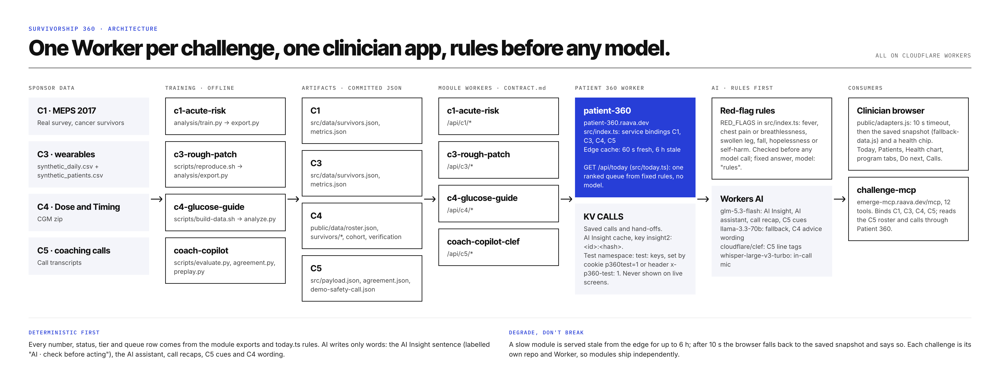
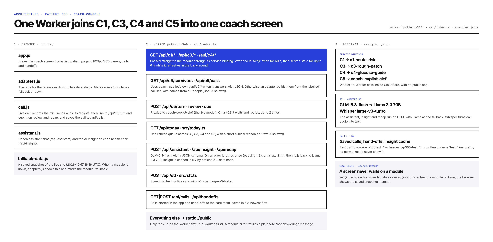
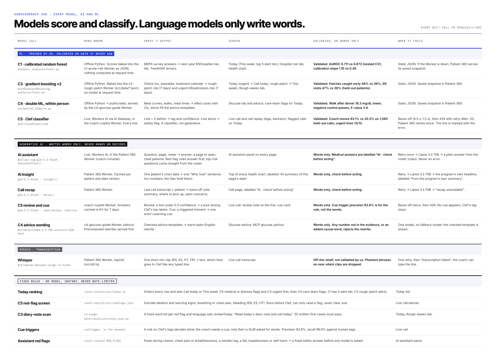

# Patient 360

One clinician-facing record for a cancer-survivorship care team. It brings four hackathon programs into one place:
hospital risk (C1), rough weeks from wearables (C3), glucose (C4) and coaching calls (C5). A built-in AI assistant
finds patients, explains their numbers, opens pages and starts calls.

**Live:** https://patient-360.raava.dev

Hospital-risk patients are real MEPS 2017 survey respondents, with IDs reassigned by the organisers. Every other
record is synthetic. Each program has its own cohort, so no patient appears in more than one program.

## How it works

**The whole system:** each challenge module is its own Cloudflare Worker with a small JSON contract; Patient 360 and the MCP server read only those contracts.



**This Worker:** the browser files, every `/api/*` route in `src/index.ts`, the service bindings to C1, C3, C4 and C5, KV, the edge cache and the snapshot fallback.



**Every model, AI and ML:** every model call in the system, where it runs, its input and output, the screen that shows it, and what happens when it fails.



Method in full, with every choice and why: [METHODOLOGY.md](METHODOLOGY.md).

## Layout

| Path | What it is |
|---|---|
| `src/index.ts` | The Cloudflare Worker (`patient-360`). It serves `public/` and `/api/*`: it proxies C1, C3, C4 and C5 through service bindings and adds the AI assistant (`/api/assistant`), AI Insight (`/api/insight`), call recaps, saved calls and hand-offs (KV), and speech-to-text. |
| `src/today.ts` | `GET /api/today`: one ranked queue across the four programs. Each row has a whole reason (never cut; it says how old a call flag is), its data type and the patient's language. |
| `src/stt.ts` | `POST /api/stt`: Whisper on Workers AI for the in-call mic. |
| `public/` | The app. Static files, no build step. `adapters.js` is the only file that knows module response shapes; `app.js` holds the pages; `call.js` the live call; `assistant.js` the AI assistant. `fallback-data.js` is a saved copy of the module APIs, used when a module is down. |
| `e2e/live.mjs` | The end-to-end test against a deployed site: real browser, real module data, about 100 checks. |
| `e2e/fixtures/` | A fixed mic clip for the speech test. |
| `scripts/snapshot.mjs` | Rebuilds `public/fallback-data.js` from the live APIs. |
| `scripts/persona-feedback.workflow.js` | The simulated-clinician feedback session run after each release (Claude Code workflow). |
| `runs/<timestamp>/manifest.json` | One file per E2E run: every check, pass or fail, with detail. Screenshots are written next to it locally and are not committed. |
| `runs/feedback-*/` | Feedback sessions: `FEEDBACK.md` plus the Playwright scripts each persona ran. |
| `runs/perf/` | Latency probes. |
| `INTEGRATION.md`, `DESIGN.md` | Module contract notes and asks; design decisions. |

## Run it

Requirements: Node 20 or later. Deploying or running against the live modules also needs a Cloudflare login
(`npx wrangler login`) on the account that hosts the module Workers.

```bash
npm ci
npx playwright install chromium      # for the E2E

# Local dev against the live module APIs. --remote runs on Cloudflare, so the service bindings
# (C1, C3, C4, C5), Workers AI and KV are the real ones.
npx wrangler dev --remote

npm run deploy                        # wrangler deploy -> patient-360.raava.dev
npm run snapshot                      # refresh the saved copy after module data changes
```

## Test it

```bash
npm run e2e                                   # against https://patient-360.raava.dev
node e2e/live.mjs https://<other-deploy>      # against another deploy
```

Each run writes `runs/<timestamp>/manifest.json` (and screenshots) and prints `N passed, M failed`. It exits
non-zero if any check fails. The test needs only network access to the site: it does not need Cloudflare
credentials. It saves one call and reads hand-offs on the live site, using a low-priority patient.

What it covers:
- every page at desktop and phone width;
- the Patients count equals the four list endpoints;
- the Today queue mixes all four programs and every row has a reason, a data-type chip and a language chip;
- the program views;
- a live call through Clef, saved and recapped;
- the mic, transcribed by Whisper;
- the AI assistant’s navigation, follow-ups and red-flag answers;
- AI Insight;
- the Play-as-live demo;
- fallback to the saved copy when a module is down.

### Reproduce on Cloudflare

`scripts/reproduce-cf/` is a small Worker (`p360-reproduce`). It starts a Cloudflare Container (the managed
`cloudflare/debian-trixie` image), makes a fresh `git clone` of this repo, then runs `npm ci`,
`npx playwright install --with-deps chromium` and `node e2e/live.mjs https://patient-360.raava.dev`. It returns
the output and the run's `manifest.json`. You do not need local Docker. To run it: `cd scripts/reproduce-cf`, then
follow the header of `src/index.js` (deploy, set `RUN_TOKEN`, run `sh run.sh`, then delete the Worker and its container app). Logged runs
are in `runs/reproduce-*.md`.
